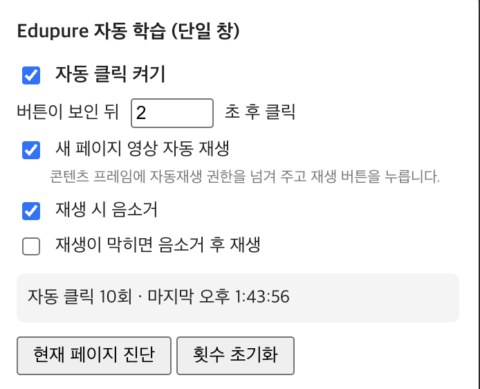

# Edupure 다음 페이지 자동 학습 (단일 창)

Edupure(edupure.net) 학습창 하나에서 **'다음 페이지 학습' 버튼을 자동으로 누르고**, 새 페이지의 영상을 **자동으로 재생**해 주는 Chrome 확장 프로그램입니다.

**배속 재생, 시청 시간 조작, 영상 건너뛰기 같은 기능은 없습니다.** 영상은 원래 속도로 끝까지 재생되며, 이 확장 프로그램은 영상이 끝난 뒤 사용자가 직접 눌러야 하는 '다음 페이지 학습' 버튼과 재생 버튼을 대신 눌러 줄 뿐입니다. 사이트의 서버나 학습 기록에 관여하지 않으므로 법적으로 문제될 소지가 있는 동작은 포함하지 않습니다.

- 버전: 2.1.0 (Manifest V3)
- 지원 사이트: `*.edupure.net`, 

---

## 1. 다운로드 및 설치

이 확장 프로그램은 Chrome 웹 스토어에 올라가 있지 않으므로 **ZIP으로 내려받아 개발자 모드로 직접 로드**합니다.

### 1-1. 다운로드

**방법 A. 배포용 ZIP 받기 (권장)**

1. 👉 **[Releases 페이지](https://github.com/lunaStratos/autoplay-edupure/releases/latest)** 에서 최신 버전의 `autoplay-edupure-vX.Y.Z.zip` 을 누릅니다. (직접 링크: [autoplay-edupure-v2.1.0.zip](https://github.com/lunaStratos/autoplay-edupure/raw/main/release/autoplay-edupure-v2.1.0.zip))
2. 내려받은 ZIP의 압축을 풉니다. `manifest.json` 이 들어 있는 `autoplay-edupure` 폴더가 생깁니다. 확장 프로그램 실행에 필요한 파일만 들어 있습니다.
3. 이 폴더는 **삭제하거나 옮기지 말고** 계속 둬야 합니다. Chrome이 이 폴더에서 직접 확장 프로그램을 읽기 때문입니다. 문서 폴더처럼 안정적인 위치에 두는 것을 권장합니다.

**방법 B. 저장소 전체 받기**

1. GitHub 저장소 페이지 https://github.com/lunaStratos/autoplay-edupure 를 엽니다.
2. 초록색 **Code** 버튼 → **Download ZIP** 을 누릅니다.
3. 내려받은 `autoplay-edupure-main.zip` 의 압축을 풉니다. 확장 프로그램 파일은 그 안의 **`src` 폴더**에 있으므로, Chrome에 로드할 때는 `src` 폴더를 선택합니다.

**방법 C. git clone**

```bash
git clone https://github.com/lunaStratos/autoplay-edupure.git
```

### 1-2. Chrome에 설치

1. Chrome 주소창에 `chrome://extensions` 를 입력해 확장 프로그램 페이지를 엽니다.
2. 오른쪽 위의 **개발자 모드** 스위치를 켭니다.
3. 왼쪽 위의 **압축해제된 확장 프로그램을 로드합니다** 버튼을 누릅니다.
4. 1-1에서 압축을 푼 폴더(`manifest.json` 이 바로 들어 있는 폴더)를 선택합니다.
5. 툴바에 확장 프로그램 아이콘이 생기면 설치 완료입니다. 퍼즐 아이콘 안에 숨어 있으면 고정(📌)해 두면 편합니다.

### 1-3. 업데이트

새 버전이 올라오면 ZIP을 다시 받아 **기존 폴더의 파일을 덮어쓴 뒤** `chrome://extensions` 에서 해당 확장 프로그램의 **새로고침(↻)** 버튼을 누릅니다. 폴더 위치가 바뀌면 Chrome이 확장 프로그램을 찾지 못하므로, 같은 폴더에 덮어쓰는 것이 중요합니다.

> 소스를 수정한 뒤에는 `chrome://extensions` 에서 해당 확장 프로그램의 **새로고침(↻)** 버튼을 눌러야 반영됩니다. 이미 열려 있는 학습창도 새로고침해야 합니다.

---

## 2. 기본 사용법

1. Edupure에 로그인해 **학습창을 엽니다.** (영상이 재생되는 창)
2. 툴바의 확장 프로그램 아이콘을 눌러 팝업을 엽니다.
3. **자동 클릭 켜기**를 체크합니다. 아이콘에 빨간 **ON** 배지가 표시됩니다.
4. 이후 영상이 끝나고 '다음 페이지 학습' 안내가 나타나면, 설정한 지연 시간 뒤에 자동으로 다음 페이지로 넘어가고 새 영상이 재생됩니다.
5. 멈추고 싶으면 팝업에서 **자동 클릭 켜기**를 해제합니다.

설정은 브라우저에 저장되므로 창을 닫거나 브라우저를 다시 켜도 유지됩니다.

---

## 3. 팝업 옵션 설명



| 옵션 | 기본값 | 설명 |
|------|--------|------|
| **자동 클릭 켜기** | 꺼짐 | 확장 프로그램 전체 ON/OFF 스위치입니다. 꺼져 있으면 아무 동작도 하지 않습니다. |
| **버튼이 보인 뒤 N초 후 클릭** | 2초 | '다음 페이지 학습' 버튼이 화면에 나타난 뒤 실제로 클릭하기까지 기다리는 시간입니다. 0~60초 사이로 설정할 수 있습니다. |
| **새 페이지 영상 자동 재생** | 켜짐 | 다음 페이지로 넘어간 뒤 영상이 0초에서 멈춰 있으면 플레이어의 재생 버튼을 눌러 줍니다. 학습창의 콘텐츠 iframe에 자동재생 권한도 함께 넘겨 줍니다. |
| **재생 시 음소거** | 꺼짐 | 영상을 항상 음소거 상태로 재생합니다. 플레이어가 페이지를 넘기면서 음소거를 풀어도 다시 음소거합니다. |
| **재생이 막히면 음소거 후 재생** | 꺼짐 | 브라우저 정책 때문에 소리 있는 자동재생이 거부될 때, 두 번째 시도부터 음소거하고 재생합니다. 소리를 듣고 싶지만 재생 실패 시에는 넘어가고 싶을 때 사용합니다. |

### 상태 표시

팝업 가운데 회색 박스에 다음 정보가 표시됩니다.

- `자동 클릭 N회 · 마지막 HH:MM:SS` : 지금까지 자동으로 누른 횟수와 마지막 클릭 시각
- `자동 중지됨: ...` : 진행 불가 알림을 만나 스스로 꺼진 경우, 그 알림 내용

### 버튼

- **현재 페이지 진단** : 현재 탭의 모든 프레임을 검사해 JSON 보고서를 출력합니다. (아래 '5. 진단' 참고)
- **복사** : 진단 결과를 클립보드에 복사합니다. 진단을 실행한 뒤에만 보입니다.
- **횟수 초기화** : 자동 클릭 횟수와 마지막 클릭 시각을 0으로 되돌립니다.

---

## 4. 동작 방식

확장 프로그램은 학습창(최상위 프레임)과 그 안의 콘텐츠 iframe 양쪽에서 동작하며, 1초마다 상태를 확인합니다.

### 콘텐츠 iframe (영상 플레이어)

1. 영상이 끝나 '다음 페이지 학습' 안내(`.complete-alarm-wrap`)가 보이면 그 안의 버튼(`#complete-next`)을 찾습니다.
   - 해당 요소가 없는 구조에서는 '다음 페이지 학습' 글자, `title`, `aria-label`, 이미지 `alt` 등을 폭넓게 검색해 버튼을 찾습니다.
2. 설정한 지연 시간을 기다린 뒤 클릭합니다. 지연 시간 동안 자동 클릭을 끄거나 버튼이 사라지면 클릭하지 않습니다.
3. 한 번 클릭한 뒤 **8초 동안은 다시 클릭하지 않습니다.** (중복 클릭 방지)
4. 새 페이지 영상이 0초에서 멈춰 있으면 플레이어의 재생 버튼(`#play`)을 누릅니다. 플레이어 버튼을 거쳐야 Edupure 쪽 학습시간 기록도 함께 시작됩니다.
   - 재생은 **3초 간격으로 최대 5회**까지만 시도합니다.
   - 사용자가 영상 중간(1초 이후)에 직접 일시정지한 경우에는 건드리지 않습니다.

### 학습창 (최상위 프레임)

1. 콘텐츠 iframe(`#bodyf`)에 `allow="autoplay; fullscreen"` 권한을 위임합니다. 원래 iframe에는 이 속성이 없어 브라우저가 소리 있는 자동재생을 막기 때문입니다. 속성만 바꾸면 이미 로드 중인 문서에는 반영되지 않아, 권한을 가진 복제 요소로 바꿔 끼워 다시 로드합니다.
2. '학습시작[PLAY]' 안내 알림창이 뜨면 자동으로 닫습니다.
3. 아래의 **진행 불가 알림**이 뜨면 자동 클릭을 스스로 끕니다.

### 자동 중지 조건

알림창 내용에 다음 문구가 포함되면 더 진행할 수 없다고 판단해 **자동 클릭을 끄고**, 팝업에 `자동 중지됨: (알림 내용)` 을 표시합니다.

- `마지막 페이지`
- `익일`
- `불가능`
- `완료되지 않았`
- `더 진행하셔야`
- `응시 후`
- `제출 후`

예: 오늘 학습 가능한 분량을 모두 마쳤거나, 시험·과제를 먼저 해야 하는 경우입니다. 알림을 확인하고 필요한 조치를 한 뒤 팝업에서 다시 **자동 클릭 켜기**를 체크하면 중지 사유가 지워지고 다시 동작합니다.

---

## 5. 진단

자동 클릭이 동작하지 않을 때 **현재 페이지 진단** 버튼으로 원인을 확인할 수 있습니다. 학습창 탭을 활성화한 상태에서 눌러야 합니다.

출력되는 JSON의 주요 항목:

| 항목 | 의미 |
|------|------|
| `frames[]` | 탭에 있는 모든 프레임 목록. `scanned: false` 이면 그 프레임에 스크립트를 주입하지 못한 것입니다. |
| `results[].url` | 각 프레임의 주소 |
| `results[].contentScript` | `true` 이면 그 프레임에 확장 프로그램 스크립트가 정상 로드된 상태 |
| `results[].buttonFound` | '다음 페이지 학습' 버튼을 찾았으면 그 HTML, 못 찾았으면 `false` |
| `results[].autoplayAllowed` | 그 프레임에서 자동재생이 허용되는지 (`false` 이면 권한 위임이 안 된 상태) |
| `results[].videos[]` | 영상의 재생/일시정지/음소거/현재 시각/길이 |
| `results[].iframes[]` | 하위 iframe의 `src` 와 `allow` 속성 |
| `results[].matches[]` | '다음'이라는 글자가 들어간 요소 후보 (최대 8개). 버튼을 못 찾을 때 실제 DOM 구조를 파악하는 데 쓰입니다. |

**복사** 버튼으로 결과를 복사해 공유하면 문제 파악에 도움이 됩니다.

브라우저 콘솔(F12 → Console)에서는 `[AutoNext]` 접두어가 붙은 로그로 클릭·재생 시도·권한 위임·자동 중지 내역을 확인할 수 있습니다.

---

## 6. 문제 해결

**아이콘에 ON 배지가 없다**
→ 팝업에서 **자동 클릭 켜기**가 꺼져 있습니다. 진행 불가 알림으로 스스로 꺼졌을 수도 있으니 팝업의 상태 박스를 확인하세요.

**버튼이 나타났는데 클릭하지 않는다**
- 설정한 지연 시간이 아직 지나지 않았거나, 직전 클릭 후 8초 쿨다운 중일 수 있습니다.
- 확장 프로그램을 새로고침했다면 학습창도 새로고침해야 합니다.
- 진단을 실행해 `contentScript` 와 `buttonFound` 값을 확인하세요.

**다음 페이지로는 넘어가는데 영상이 재생되지 않는다**
- **새 페이지 영상 자동 재생** 옵션이 켜져 있는지 확인하세요.
- 진단에서 `autoplayAllowed` 가 `false` 이면 브라우저가 소리 있는 자동재생을 막고 있는 것입니다. **재생이 막히면 음소거 후 재생** 또는 **재생 시 음소거**를 켜 보세요.
- 재생 시도는 최대 5회까지입니다. 페이지를 새로고침하면 다시 시도합니다.

**소리가 안 난다**
→ **재생 시 음소거**가 켜져 있거나, **재생이 막히면 음소거 후 재생**이 동작한 경우입니다. 플레이어에서 직접 음소거를 해제하거나 옵션을 조정하세요.


---

## 7. 파일 구성

```
autoplay-edupure/
├── src/            확장 프로그램 소스 (개발용, Chrome에 직접 로드 가능)
│   ├── manifest.json
│   ├── background.js
│   ├── content.js
│   ├── popup.html
│   └── popup.js
├── release/        배포용 ZIP (사용자는 이것만 받으면 됨)
├── build.sh        src/ 를 묶어 release/ ZIP을 만드는 스크립트
├── image.png       팝업 스크린샷
└── README.md
```

| 파일 | 역할 |
|------|------|
| `src/manifest.json` | 확장 프로그램 정보, 권한, 실행 대상 도메인 |
| `src/background.js` | 서비스 워커. 자동 클릭이 켜져 있으면 툴바 아이콘에 **ON** 배지를 표시 |
| `src/popup.html` / `src/popup.js` | 툴바 아이콘 클릭 시 열리는 설정 팝업. 옵션 저장, 통계 표시, 페이지 진단 |
| `src/content.js` | 학습창과 콘텐츠 iframe에 주입되는 핵심 로직. 버튼 탐지·클릭, 영상 재생, 자동재생 권한 위임, 알림창 처리 |
| `release/` | 배포용 ZIP. 확장 프로그램 실행에 필요한 파일만 묶어 둔 것으로, 사용자는 이 ZIP만 받으면 됩니다 |
| `build.sh` | `src/manifest.json` 의 버전을 읽어 `release/autoplay-edupure-v<버전>.zip` 을 다시 만듭니다 |

### 개발 및 배포

```bash
# 개발: chrome://extensions 에서 src/ 폴더를 "압축해제된 확장 프로그램 로드"로 지정
# 배포: 버전을 올린 뒤 ZIP을 다시 만들고 GitHub Release에 첨부
./build.sh
```

### 사용 권한

| 권한 | 용도 |
|------|------|
| `storage` | 옵션과 클릭 횟수 저장 |
| `scripting` | 진단 기능에서 각 프레임에 검사 스크립트 실행 |
| `webNavigation` | 진단 기능에서 탭의 프레임 목록 조회 |
| `host_permissions` | `edupure.net`, 에서만 동작 |

---

## 8. 주의사항

- 이 도구는 영상 시청 중 **반복적으로 '다음' 버튼과 재생 버튼을 누르는 작업만** 대신합니다. 학습 내용 이해, 시험·과제 응시는 대신하지 않습니다.
- **배속 재생, 영상 건너뛰기, 시청 시간·진도율 조작, 서버 요청 변조 등은 일절 하지 않습니다.** 영상은 플레이어가 정한 속도로 끝까지 재생되고, 다음 페이지로 넘어가는 것도 사이트가 버튼을 보여 준 뒤에만 이루어집니다. 즉 사용자가 손으로 눌렀을 때와 동일한 동작만 자동화합니다.
- 소속 기관의 학습 규정상 자동화 도구 사용이 제한될 수 있습니다. 사용 전 규정을 확인하세요.
- Edupure 페이지 구조가 바뀌면 버튼을 찾지 못할 수 있습니다. 이때는 **현재 페이지 진단** 결과의 `matches` 항목을 참고해 `src/content.js` 의 `findButton()` 을 수정하세요.
